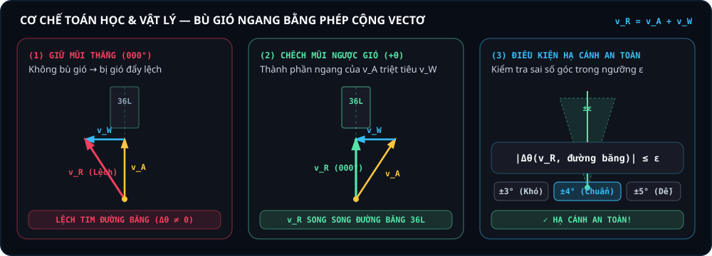
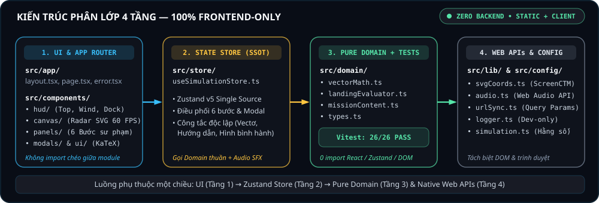

<div align="center">
  

  <h1>NHIỆM VỤ VECTƠ • TOÁN 10</h1>
  <p>
    <strong>Mô phỏng Buồng lái Radar Tương tác — Phép cộng, Phép trừ Vectơ &amp; Quy tắc Hình bình hành (CT GDPT 2018)</strong>
  </p>

  <p>
    
    
    
    
    
  </p>
</div>

---

## 1. Giới thiệu Tổng quan

**Nhiệm vụ Vectơ • Toán 10** (*Vector Quest*) là ứng dụng web mô phỏng vật lý – toán học tương tác theo phong cách **Aerospace HUD Buồng lái**, giúp học sinh lớp 10 (Chương trình GDPT 2018) làm chủ kiến thức **Phép cộng và Phép trừ Vectơ** thông qua trải nghiệm nhập vai phi công hạ cánh trên **Đường băng 36L** giữa cơn gió ngang.

Thay vì giải bài tập thuần túy trên giấy, người học trực tiếp quan sát máy bay bị gió ngang đẩy lệch, thảo luận dự đoán hướng xử lý, kéo thả vectơ vận tốc máy bay $\vec{v}_A$ theo thời gian thực để đưa vectơ vận tốc tổng hợp $\vec{v}_R = \vec{v}_A + \vec{v}_W$ song song với tim đường băng, và chiêm ngưỡng chứng minh hình học qua **Quy tắc hình bình hành**.

- **Đối tượng sử dụng:** Giáo viên giảng dạy trên lớp (tương thích máy chiếu & bảng tương tác) và học sinh tự thực hành trên trình duyệt.
- **Kiến trúc triển khai:** **100% Frontend-only** (không cần backend, không cơ sở dữ liệu, không biến môi trường bí mật), sẵn sàng deploy tức thì lên **Vercel**.

---

## 2. Tính năng Nổi bật

### Luồng Sư phạm 6 Bước Tương tác
1. **Bước 01 — Mở đầu (`CƠN GIÓ NGANG BẤT NGỜ!`):** Quan sát trực quan cách gió ngang đẩy lệch quỹ đạo máy bay khỏi tim đường băng 36L khi giữ mũi thẳng `360°`.
2. **Bước 02 — Thử thách Phi công (`EM SẼ XỬ LÝ THẾ NÀO?`):** Thảo luận mở cùng **Cung dự đoán hướng mũi** trước khi mở các phương án trắc nghiệm.
3. **Bước 03 — Quan sát & Dự đoán (Lưới Radar 2×2 `[A–D]`):** Chọn hướng mũi máy bay (`[A] Giữ bay thẳng`, `[B] Rẽ phải gắt`, `[C] Rẽ sang trái`, `[D] Rẽ nhẹ sang phải`) bằng chuột hoặc phím `A–D`. Hệ thống kiểm tra đáp án thích ứng động theo chiều gió hiện tại.
4. **Bước 04 — Kiểm chứng Vectơ (`CÙNG KIỂM TRA!`):** Kéo thả trực tiếp tay cầm **`KÉO ĐẦU`** của mũi tên vàng $\vec{v}_A$ ở tốc độ **60 FPS** trên cả chuột và màn hình cảm ứng (Native SVG Pointer Events + `setPointerCapture` + `touch-action: none`), hoặc tinh chỉnh góc bù gió trong khoảng $[-60^\circ, +60^\circ]$.
5. **Bước 05 — Kết quả Hạ cánh (`KIỂM TRA HẠ CÁNH`):** Đánh giá điều kiện song song với đường băng 36L; nếu chưa đạt sẽ giữ nguyên góc mũi hiện tại để học sinh điều chỉnh tiếp mà không bị reset mất góc.
6. **Bước 06 — Giải thích (`CHÚNG TA ĐÃ KHÁM PHÁ ĐƯỢC GÌ?`):** Làm mờ nền đường băng, bật/tắt **Đường dựng hình bình hành** và **Hệ trục tọa độ Oxy** quanh gốc chung $O(0,0)$ để kiểm chứng trực quan $\vec{v}_R = \vec{v}_A + \vec{v}_W$ và $\vec{v}_A = \vec{v}_R - \vec{v}_W$.

### Các Công cụ Hỗ trợ Giảng dạy Lớp học
- **Bảng Điều khiển Gió ngang Động:** Đổi chiều gió **Phải → Trái (`090° ĐÔNG`)** hoặc **Trái → Phải (`270° TÂY`)** cùng 3 mức cường độ **Nhẹ (`15 KT`)**, **Vừa (`25 KT`)**, **Mạnh (`40 KT`)** với vận tốc máy bay chuẩn `140 KT`.
- **Công tắc Độc lập trên Thanh đáy:** Nút **Ẩn/Hiện vectơ** chỉ ẩn/hiện 3 mũi tên vectơ trên radar; nút **Hướng dẫn** ẩn/hiện gợi ý sư phạm mà không làm thay đổi trạng thái vật lý.
- **2 Chế độ Giao diện Lớp học:** **Buồng lái tối** (mặc định, độ tương phản cao trên màn hình) và **Máy chiếu sáng** (`.theme-daylight`, tối ưu cho phòng học nhiều ánh sáng).
- **Âm thanh Phản hồi Web Audio API:** Tổng hợp âm click, âm báo thành công và cảnh báo nhẹ trực tiếp bằng `AudioContext` (có nút bật/tắt nhanh và xử lý an toàn khi trình duyệt chặn autoplay).
- **3 Hộp thoại Tiện ích:** Minh họa trực quan (`Video`), Cài đặt Buồng lái (`Settings` — cấu hình sai số góc $\varepsilon$: `±3° / ±4° / ±5°`), và Cẩm nang Phi công (`Trợ giúp` — bảng phím tắt).

---

## 3. Cơ chế Toán học & Vật lý

<div align="center">
  
</div>

Trong mặt phẳng tọa độ gắn với đường băng 36L (trục $Oy$ hướng Bắc dọc theo tim đường băng):

- **Vectơ vận tốc máy bay so với không khí:** $\vec{v}_A$ (màu vàng, độ lớn mặc định $140\text{ KT}$).
- **Vectơ vận tốc gió ngang:** $\vec{v}_W$ (màu xanh dương, độ lớn $15 / 25 / 40\text{ KT}$ theo phương ngang $Ox$).
- **Vectơ vận tốc tổng hợp (quỹ đạo thực tế):**

$$\vec{v}_R = \vec{v}_A + \vec{v}_W \quad \Longleftrightarrow \quad \vec{v}_A = \vec{v}_R - \vec{v}_W$$

- **Điều kiện cân bằng thành phần ngang & hạ cánh an toàn:** Để quỹ đạo thực tế $\vec{v}_R$ song song với tim đường băng 36L, thành phần vận tốc ngang của máy bay phải triệt tiêu gió ngang ($\sin\theta = \dfrac{|\vec{v}_W|}{|\vec{v}_A|}$), và độ lệch góc phải thỏa mãn:

$$|\Delta\theta(\vec{v}_R, \text{đường băng 36L})| \le \varepsilon \quad (\varepsilon \in \{3^\circ, 4^\circ, 5^\circ\},\ \text{mặc định } \pm 4^\circ)$$

---

## 4. Công nghệ Sử dụng & Kiến trúc Hệ thống

<div align="center">
  
</div>

### Thư viện & Công nghệ Cốt lõi (theo `package.json`)

| Thành phần | Công nghệ / Thư viện | Phiên bản | Vai trò trong dự án |
| :--- | :--- | :---: | :--- |
| **Framework** | `next` (App Router) | `16.4.6` | Khung ứng dụng Static + Client-side tối ưu cho Vercel |
| **UI Runtime** | `react` / `react-dom` | `19.3.0` | Dựng giao diện HUD, SVG Radar & các bước sư phạm |
| **Ngôn ngữ** | `typescript` | `^5` | Strict typing cho toán học vectơ và state |
| **Styling** | `tailwindcss` / `@tailwindcss/turbopack` | `4.3.3` | Design system tokens (Dark Cockpit & Daylight Projector) |
| **State** | `zustand` | `^5.1.0` | Single Source of Truth cho mô phỏng 6 bước & UI |
| **Toán học** | `katex` | `^0.19.1` | Render sắc nét công thức vectơ ($\vec{v}_A, \vec{v}_W, \vec{v}_R, \Delta\theta, \varepsilon$) |
| **Chuyển động & Icon** | `motion` / `lucide-react` | `^14.14.0` / `^1.78.0` | Chuyển cảnh mượt giữa 6 bước & hệ thống icon buồng lái |
| **Kiểm thử** | `vitest` | `^5.1.1` | Unit test cho Domain thuần khiết (`26/26` tests PASS) |

### Cây Thư mục Dự án

```text
vector-quest/
├── docs/
│   ├── assets/                     # Bộ SVG minh họa sản phẩm (hero, mechanics, architecture)
│   ├── architecture.md             # Tài liệu kiến trúc phân lớp
│   ├── product_requirements.md     # Đặc tả yêu cầu sản phẩm & sư phạm
│   ├── project_blueprint.md        # Bản thiết kế tổng thể
│   └── tech_stack.md               # Thẩm định công nghệ
├── src/
│   ├── app/                        # Next.js App Router (layout, page, globals, error)
│   ├── components/
│   │   ├── canvas/                 # AirportRadarCanvas, WindParticles, Aircraft, VectorOverlay, LiveTelemetryHud
│   │   ├── hud/                    # TopPillBar, WindTelemetryPill, BottomControlDock
│   │   ├── modals/                 # SettingsModal, HelpModal, VideoDemoModal
│   │   ├── panels/                 # ChallengePanelHost + StepBriefing..StepExplain (6 bước)
│   │   └── ui/                     # MathFormula (KaTeX), CanvasErrorBoundary
│   ├── config/
│   │   └── simulation.ts           # Hằng số vật lý, tọa độ radar & sai số mặc định
│   ├── domain/                     # Pure TypeScript (0 phụ thuộc React/Zustand/DOM)
│   │   ├── landingEvaluator.ts     # Đánh giá hạ cánh |Δθ| ≤ ε & chấm điểm Bước 3
│   │   ├── missionContent.ts       # Nội dung sư phạm Toán 10 Tiếng Việt
│   │   ├── types.ts                # Kiểu dữ liệu miền nghiệp vụ
│   │   └── vectorMath.ts           # Phép cộng vectơ, góc lệch, hình bình hành
│   ├── lib/                        # Web APIs adapters (audio, svgCoords, urlSync, logger)
│   └── store/
│       └── useSimulationStore.ts   # Zustand Single Source of Truth
├── tests/domain/                   # Bộ kiểm thử Vitest (vectorMath, landingEvaluator, urlSync)
├── next.config.ts
├── package.json
├── README.md
└── update.md                       # Nhật ký tiến độ & kiểm chứng
```

---

## 5. Hướng dẫn Cài đặt & Chạy Local

### Yêu cầu Hệ thống
- **Node.js** `>= 20.x` (đã xác nhận hoạt động ổn định trên `v26.4.0`)
- **npm** `>= 10.x`

### Các lệnh Thực thi

```bash
# 1. Cài đặt thư viện phụ thuộc
npm install

# 2. Chạy server phát triển (http://localhost:3000)
npm run dev

# 3. Chạy bộ kiểm thử đơn vị (Vitest - 26/26 tests)
npm test

# 4. Kiểm tra ESLint
npm run lint

# 5. Build bản production (next build --webpack)
npm run build

# 6. Khởi chạy bản production local
npm run start
```

---

## 6. Phím tắt Lớp học & Chia sẻ Kịch bản URL

### Phím tắt Điều khiển Nhanh
*(Tự động vô hiệu hóa khi đang mở hộp thoại Settings / Help / Video để tránh xung đột)*

| Phím tắt | Chức năng |
| :---: | :--- |
| `A`, `B`, `C`, `D` | Chọn nhanh phương án `[A–D]` tại **Bước 3** |
| `Space` | **Tạm dừng / Tiếp tục** hiệu ứng gió & máy bay |
| `←` / `→` | Chuyển **Bước trước / Bước tiếp theo** (`1–6`) |
| `Esc` | Đóng hộp thoại (Modal) đang mở |

### Chia sẻ Kịch bản qua URL Query Params
Giáo viên có thể tạo link mở sẵn tình huống gió và bước học cụ thể cho học sinh qua 3 tham số `dir`, `strength`, `step`:

- **Gió Trái → Phải mạnh (`40 KT`), mở thẳng Phòng thí nghiệm Vectơ (Bước 4):**
  ```text
  /?dir=ltr&strength=strong&step=4
  ```
- **Gió Phải → Trái nhẹ (`15 KT`), mở thẳng Bước 3 (Dự đoán):**
  ```text
  /?dir=rtl&strength=light&step=3
  ```
- **Mở nhanh Bước 6 (Giải thích Quy tắc Hình bình hành):**
  ```text
  /?dir=rtl&strength=moderate&step=6
  ```

---

## 7. Hướng dẫn Deploy lên Vercel & Checklist trước khi Push Git

### Deploy Zero-Config lên Vercel
1. Đẩy mã nguồn lên repository GitHub / GitLab / Bitbucket.
2. Truy cập [Vercel Dashboard](https://vercel.com/new) và chọn **Import Project**.
3. Giữ nguyên **Framework Preset: `Next.js`** (ứng dụng chạy `100%` phía client, **không cần** cấu hình biến môi trường hay database).
4. Nhấn **Deploy** và chia sẻ URL cho lớp học.

### Checklist Kiểm tra trước khi Push Git
- [x] `npx tsc --noEmit` — **PASS** (0 lỗi kiểu dữ liệu)
- [x] `npm run lint` — **PASS** (0 lỗi ESLint)
- [x] `npm test` (`vitest run`) — **PASS** (`26/26` unit tests)
- [x] `npm run build` — **PASS** (`next build --webpack` thành công)
- [x] Kiểm thử trình duyệt Microsoft Edge (`1280×720` & `1920×1080`) — **PASS** (`28/28` assertions, 0 console errors)
- [x] Kiểm tra `git status` sạch sẽ, không commit thư mục `.next/`, `node_modules/` hay file tạm.
