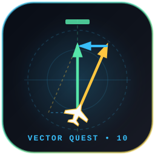
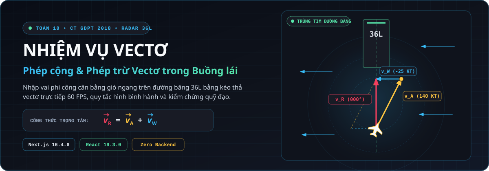

<div align="center">
  

  <h1>NHIỆM VỤ VECTƠ • TOÁN 10</h1>
  <p>
    <strong>Mô phỏng Buồng lái Radar Tương tác — Phép cộng, Phép trừ Vectơ &amp; Quy tắc Hình bình hành (CT GDPT 2018)</strong>
  </p>

  <p>
    
    
    
    
    
    
  </p>

  
</div>

---

## 1. Giới thiệu Tổng quan

**Nhiệm vụ Vectơ • Toán 10** (*Vector Quest*) là ứng dụng web mô phỏng vật lý – toán học tương tác theo phong cách **Aerospace HUD Buồng lái**, giúp học sinh lớp 10 (Chương trình GDPT 2018) làm chủ kiến thức **Phép cộng và Phép trừ Vectơ** thông qua trải nghiệm nhập vai phi công hạ cánh trên **Đường băng 36L** giữa cơn gió ngang.

Thay vì giải bài tập thuần túy trên giấy, học sinh được trực tiếp quan sát máy bay bị gió ngang đẩy lệch, thảo luận dự đoán hướng xử lý, kéo thả hoặc tinh chỉnh góc mũi máy bay $\vec{v}_A$ theo thời gian thực để đưa vectơ vận tốc tổng hợp $\vec{v}_R = \vec{v}_A + \vec{v}_W$ song song với trục đường băng, và kiểm chứng hình học bằng **Quy tắc hình bình hành**.

- **Đối tượng sử dụng:** Giáo viên giảng dạy trên lớp (tối ưu cho TV/máy chiếu 1280×720, 1920×1080 & bảng tương tác) và học sinh tự thực hành trên trình duyệt.
- **Kiến trúc triển khai:** **100% Frontend-only** (không cần backend, không cơ sở dữ liệu, lưu trữ cục bộ bằng `localStorage` + chia sẻ qua URL query params), sẵn sàng deploy tức thì lên **Vercel**.

---

## 2. Tính năng Nổi bật

### Luồng Sư phạm 6 Bước Tương tác
1. **Bước 01 — Mở đầu (`CƠN GIÓ NGANG BẤT NGỜ!`):** Quan sát trực quan cách gió ngang đẩy lệch quỹ đạo máy bay khỏi tim đường băng 36L khi giữ mũi thẳng `360°`.
2. **Bước 02 — Thử thách Phi công (`EM SẼ XỬ LÝ THẾ NÀO?`):** Thảo luận mở cùng **Cung dự đoán hướng mũi** trước khi mở các phương án trắc nghiệm.
3. **Bước 03 — Quan sát & Dự đoán (Lưới Radar 2×2 `[A–D]`):** Chọn hướng mũi máy bay (`[A] Giữ bay thẳng`, `[B] Rẽ phải gắt`, `[C] Rẽ sang trái`, `[D] Rẽ nhẹ sang phải`) bằng chuột hoặc phím `A–D`. Hệ thống kiểm tra đáp án thích ứng động theo chiều gió hiện tại.
4. **Bước 04 — Kiểm chứng Vectơ (`CÙNG KIỂM TRA!`):** Kéo thả trực tiếp tay cầm **`KÉO ĐẦU`** của mũi tên vàng $\vec{v}_A$ ở tốc độ **60 FPS** (hỗ trợ giữ `Shift` để kéo siêu mịn `0.1°` và tự hút nhẹ quanh góc cân bằng chuẩn), hoặc dùng thanh trượt + cụm **7 nút tinh chỉnh chính xác (`-5°`, `-1°`, `-0.5°`, `0°`, `+0.5°`, `+1°`, `+5°`)** hỗ trợ nhấn giữ liên tục (*press-and-hold*).
5. **Bước 05 — Kết quả Hạ cánh (`KIỂM TRA HẠ CÁNH`):** Đánh giá điều kiện $\vec{v}_R$ song song với trục đường băng (hỗ trợ cả đường băng nghiêng từ `-45°` đến `+45°`); nếu chưa đạt sẽ **giữ nguyên góc mũi hiện tại** để học sinh sửa tiếp mà không bị reset mất góc.
6. **Bước 06 — Giải thích (`CHÚNG TA ĐÃ KHÁM PHÁ ĐƯỢC GÌ?`):** Làm mờ nền đường băng, bật/tắt **Đường dựng hình bình hành** và **Hệ trục tọa độ Oxy** quanh gốc chung $O(0,0)$ để kiểm chứng trực quan $\vec{v}_R = \vec{v}_A + \vec{v}_W$ và $\vec{v}_A = \vec{v}_R - \vec{v}_W$.

### Ngăn Tùy biến Giáo viên (*Teacher Studio*) & Trình chiếu Lớp học
- **Chuyển đổi Song ngữ `VI ↔ EN` tức thì:** Nút **`VI | EN`** ngay trên thanh điều hướng trên cùng (và trong `Cài đặt`) giúp đổi toàn bộ giao diện, SVG Radar, 6 bước bài giảng và hộp thoại giữa Tiếng Việt và Tiếng Anh mà **không làm mất** bước hiện tại, góc mũi, tốc độ gió hay nét vẽ; lưu tự động vào `localStorage` (`vq_language_v1`) và đồng bộ qua `?lang=en`.
- **Chế độ Phép cộng & Phép trừ Vectơ (`add` / `subtract`):** Linh hoạt chuyển giữa tìm quỹ đạo tổng hợp ($\vec{v}_R = \vec{v}_A + \vec{v}_W$) và tìm hướng mũi bù gió ($\vec{v}_A = \vec{v}_R - \vec{v}_W$).
- **Bộ đề Số đẹp Tính nhẩm & Tùy biến Độ lớn:** Chọn nhanh các bộ số đẹp để học sinh tính tay trên lớp:
  - *Chuẩn Hàng không:* $|\vec{v}_A| = 140\text{ KT},\ |\vec{v}_W| = 25\text{ KT}\ (\approx 18.4^\circ)$
  - *Góc đẹp $30^\circ$:* $|\vec{v}_A| = 100\text{ KT},\ |\vec{v}_W| = 50\text{ KT}\ (\sin 30^\circ = \tfrac{1}{2})$
  - *Góc đẹp $45^\circ$:* $|\vec{v}_A| = 100\text{ KT},\ |\vec{v}_W| = 70.7\text{ KT}\ (\sin 45^\circ \approx \tfrac{\sqrt{2}}{2})$
  - *Bộ số Pytago 3–4–5:* $|\vec{v}_A| = 100\text{ KT},\ |\vec{v}_W| = 60\text{ KT}\ (\approx 36.9^\circ)$
  - *Đường băng chéo $+30^\circ$:* Đường băng xoay $+30^\circ$, $|\vec{v}_A| = 100\text{ KT},\ |\vec{v}_W| = 50\text{ KT}$
  - Hoặc kéo thanh trượt tùy biến $|\vec{v}_A|$ (`60–200 KT`), $|\vec{v}_W|$ (`5–100 KT`) và xoay góc đường băng (`-45°` đến `+45°`).
- **Chế độ Giấu số liệu (*Blind Classroom Mode*):** Ẩn giá trị $\Delta\theta$, $\vec{v}_R$ và thành phần ngang $v_{A_x}$ bằng `??.?°` / `?? KT` để học sinh tự tính nhẩm trên giấy trước khi nhấn **Mở đáp án**.
- **Bút ghi chú trên Radar (*Radar Chalk Overlay*):** Vẽ trực tiếp ghi chú/khoanh vùng lên mặt Radar khi giảng bài và xóa nhanh chỉ với 1 nút bấm.
- **Tối ưu TV & Máy chiếu Lớp học:** Hỗ trợ phóng đại cỡ chữ **TV Scale (`100% / 115% / 125%`)**, 2 giao diện **Buồng lái tối (*Dark Cockpit*)** và **Máy chiếu sáng (*Daylight Avionics*)**, cùng mô hình máy bay SVG đa lớp chân thực (thân khối 3D, kính lái, động cơ phản lực, đèn đầu cánh đỏ/xanh lá, bóng đổ).
- **Lưu Bộ đề & Chia sẻ Link Bài giảng:** Lưu tới 8 bộ đề cá nhân vào `localStorage` (`vq_teacher_presets_v1`) và sao chép URL chia sẻ mở đúng đề bài cho cả lớp.

### Các Công cụ Điều khiển Khác
- **Bảng Gió ngang Động:** Đổi chiều gió **Phải → Trái (`090° ĐÔNG`)** hoặc **Trái → Phải (`270° TÂY`)**, chọn nhanh **Nhẹ (`15 KT`) / Vừa (`25 KT`) / Mạnh (`40 KT`)** hoặc tăng/giảm từng **`-5 / +5 KT`**.
- **Công tắc Độc lập trên Thanh đáy:** Nút **Ẩn/Hiện vectơ** chỉ ẩn/hiện 3 mũi tên vectơ trên radar; nút **Hướng dẫn** ẩn/hiện gợi ý sư phạm & nút gợi ý góc cân bằng lý tưởng mà không làm thay đổi trạng thái vật lý.
- **Âm thanh Phản hồi Web Audio API:** Tổng hợp âm click, âm báo thành công và cảnh báo nhẹ trực tiếp bằng `AudioContext` (có nút bật/tắt nhanh).
- **4 Hộp thoại Tiện ích:** Teacher Studio (`Giáo viên`), Minh họa trực quan (`Video`), Cài đặt Buồng lái (`Settings` — cấu hình sai số góc $\varepsilon \in \{\pm 3^\circ, \pm 4^\circ, \pm 5^\circ\}$, ngôn ngữ `VI/EN`, giao diện Sáng/Tối, âm thanh), và Cẩm nang Phi công (`Trợ giúp`).

---

## 3. Cơ chế Toán học & Vật lý

<div align="center">
  
</div>

Trong mặt phẳng tọa độ gắn với hướng Bắc ($+y$) và hướng Đông ($+x$):

- **Vectơ vận tốc máy bay so với không khí:** $\vec{v}_A$ (màu vàng, độ lớn mặc định $140\text{ KT}$ hoặc tùy chỉnh trong Teacher Studio).
- **Vectơ vận tốc gió ngang:** $\vec{v}_W$ (màu xanh dương, độ lớn $15 / 25 / 40\text{ KT}$ hoặc tùy chỉnh $5–100\text{ KT}$ theo phương ngang $Ox$).
- **Vectơ vận tốc tổng hợp (quỹ đạo thực tế):**

$$\vec{v}_R = \vec{v}_A + \vec{v}_W \quad \Longleftrightarrow \quad \vec{v}_A = \vec{v}_R - \vec{v}_W$$

- **Điều kiện cân bằng thành phần ngang & hạ cánh an toàn:** Với đường băng có góc xoay $\varphi \in [-45^\circ, +45^\circ]$ (mặc định $\varphi = 0^\circ$ là đường băng 36L thẳng đứng), góc bù gió lý tưởng thỏa mãn thành phần vận tốc vuông góc trục đường băng bằng $0$, và độ lệch góc phải nằm trong ngưỡng an toàn:

$$|\Delta\theta(\vec{v}_R, \text{trục đường băng})| \le \varepsilon \quad (\varepsilon \in \{3^\circ, 4^\circ, 5^\circ\},\ \text{mặc định } \pm 4^\circ)$$

---

## 4. Công nghệ Sử dụng & Kiến trúc Hệ thống

<div align="center">
  
</div>

### Thư viện & Công nghệ Cốt lõi (theo `package.json`)

| Thành phần | Công nghệ / Thư viện | Phiên bản | Vai trò trong dự án |
| :--- | :--- | :---: | :--- |
| **Framework** | `next` (App Router) | `16.4.6` | Khung ứng dụng Static + Client-side tối ưu cho Vercel |
| **UI Runtime** | `react` / `react-dom` | `19.3.0` | Dựng giao diện HUD, SVG Radar & các bước sư phạm |
| **Ngôn ngữ** | `typescript` | `^5` | Strict typing cho toán học vectơ, i18n và state |
| **Styling** | `tailwindcss` / `@tailwindcss/turbopack` | `4.3.3` | Design system tokens (Dark Cockpit, Daylight Avionics & TV Scale) |
| **State** | `zustand` | `^5.1.0` | Single Source of Truth cho mô phỏng 6 bước, Teacher Studio & song ngữ |
| **Toán học** | `katex` | `^0.19.1` | Render sắc nét công thức vectơ ($\vec{v}_A, \vec{v}_W, \vec{v}_R, \Delta\theta, \varepsilon$) |
| **Chuyển động & Icon** | `motion` / `lucide-react` | `^14.14.0` / `^1.78.0` | Chuyển cảnh mượt giữa 6 bước & hệ thống icon buồng lái |
| **Kiểm thử** | `vitest` | `^5.1.1` | Unit test cho Domain thuần khiết, URL Sync & i18n (`35/35` tests PASS) |

### Cây Thư mục Dự án

```text
vector-quest/
├── docs/
│   ├── assets/                     # Bộ SVG minh họa sản phẩm (logo, hero, mechanics, architecture)
│   ├── architecture.md             # Tài liệu kiến trúc phân lớp
│   ├── implementation_plan.md      # Kế hoạch triển khai theo từng phase
│   ├── product_requirements.md     # Đặc tả yêu cầu sản phẩm & sư phạm
│   ├── project_blueprint.md        # Bản thiết kế tổng thể
│   └── tech_stack.md               # Thẩm định công nghệ
├── public/
│   └── logo.svg                    # Biểu trưng chính hiển thị trên header web
├── src/
│   ├── app/                        # Next.js App Router (layout, page, globals, error, icon.svg)
│   ├── components/
│   │   ├── canvas/                 # AirportRadarCanvas (+ Chalk), WindParticles, Aircraft, VectorOverlay, LiveTelemetryHud
│   │   ├── hud/                    # TopPillBar (+ VI|EN), WindTelemetryPill, BottomControlDock
│   │   ├── modals/                 # TeacherStudioModal, SettingsModal, HelpModal, VideoDemoModal
│   │   ├── panels/                 # ChallengePanelHost + StepBriefing..StepExplain (6 bước)
│   │   └── ui/                     # MathFormula (KaTeX), RealisticAircraftSvg, CanvasErrorBoundary
│   ├── config/
│   │   └── simulation.ts           # Hằng số vật lý, tọa độ radar & sai số mặc định
│   ├── domain/                     # Pure TypeScript (0 phụ thuộc React/Zustand/DOM)
│   │   ├── landingEvaluator.ts     # Đánh giá hạ cánh |Δθ| ≤ ε & chấm điểm Bước 3
│   │   ├── missionContent.ts       # Nội dung sư phạm Toán 10 song ngữ Việt – Anh
│   │   ├── types.ts                # Kiểu dữ liệu miền nghiệp vụ & LocalizedText
│   │   └── vectorMath.ts           # Phép cộng/trừ vectơ, góc lệch, đường băng xoay, bộ đề số đẹp
│   ├── lib/                        # Web APIs adapters (audio, i18n, svgCoords, urlSync, logger)
│   └── store/
│       └── useSimulationStore.ts   # Zustand Single Source of Truth
├── tests/domain/                   # Bộ kiểm thử Vitest (vectorMath, landingEvaluator, urlSync, i18n)
├── next.config.ts
├── package.json
├── README.md
└── update.md                       # Nhật ký tiến độ & kiểm chứng
```

---

## 5. Hướng dẫn Cài đặt & Chạy Local

### Yêu cầu Hệ thống
- **Node.js** `>= 20.x` (đã xác nhận hoạt động ổn định trên `v26.4.0`)
- **npm** `>= 10.x`

### Các lệnh Thực thi

```bash
# 1. Cài đặt thư viện phụ thuộc
npm install

# 2. Chạy server phát triển (http://localhost:3000)
npm run dev

# 3. Chạy bộ kiểm thử đơn vị (Vitest - 35/35 tests)
npm test

# 4. Kiểm tra TypeScript & ESLint
npx tsc --noEmit
npm run lint

# 5. Build bản production (next build --webpack)
npm run build

# 6. Khởi chạy bản production local
npm run start
```

---

## 6. Phím tắt Lớp học & Chia sẻ Kịch bản URL

### Phím tắt Điều khiển Nhanh
*(Tự động vô hiệu hóa khi đang mở hộp thoại Teacher Studio / Settings / Help / Video để tránh xung đột)*

| Phím tắt | Chức năng |
| :---: | :--- |
| `A`, `B`, `C`, `D` | Chọn nhanh phương án `[A–D]` tại **Bước 3** |
| `↑` / `↓` hoặc `+` / `-` | Tinh chỉnh góc mũi máy bay từng `0.5°` tại **Bước 4–5** |
| `Shift + ↑` / `Shift + ↓` | Tinh chỉnh góc mũi siêu mịn `0.1°` tại **Bước 4–5** |
| `Space` | **Tạm dừng / Tiếp tục** hiệu ứng gió & máy bay |
| `←` / `→` | Chuyển **Bước trước / Bước tiếp theo** (`1–6`) |
| `Esc` | Đóng hộp thoại (Modal) đang mở |

### Chia sẻ Kịch bản qua URL Query Params
Giáo viên có thể chia sẻ link mở sẵn kịch bản bài giảng với đầy đủ các tham số tùy biến:

| Tham số | Giá trị hợp lệ | Ý nghĩa |
| :--- | :--- | :--- |
| `dir` | `rtl` \| `ltr` | Chiều gió (Phải → Trái / Trái → Phải) |
| `strength` | `light` \| `moderate` \| `strong` | Cường độ gió mặc định (`15 / 25 / 40 KT`) |
| `step` | `1` .. `6` | Mở thẳng bước học mong muốn |
| `mode` | `add` \| `subtract` | Chế độ Phép cộng hoặc Phép trừ vectơ |
| `va` / `vw` | Số thực (`40..250` / `5..150`) | Tùy chỉnh độ lớn $|\vec{v}_A|$ và $|\vec{v}_W|$ (KT) |
| `rw` | `-45` .. `45` | Góc xoay trục đường băng (độ) |
| `blind` | `1` \| `true` | Bật Chế độ Giấu số liệu cho học sinh tự tính |
| `tv` | `normal` \| `large` \| `xlarge` | Cỡ chữ trình chiếu TV (`100% / 115% / 125%`) |
| `lang` | `vi` \| `en` | Ngôn ngữ hiển thị mặc định của link bài giảng |

**Ví dụ nhanh:**
- **Mở bài tập Phép trừ vectơ, bộ số góc $30^\circ$, giấu số liệu ở Bước 4:**
  ```text
  /?dir=rtl&strength=strong&step=4&mode=subtract&va=100&vw=50&blind=1
  ```
- **Mở giao diện Tiếng Anh ngay tại Bước 6 (Quy tắc Hình bình hành):**
  ```text
  /?dir=rtl&strength=moderate&step=6&lang=en
  ```

---

## 7. Hướng dẫn Deploy lên Vercel & Checklist trước khi Push Git

### Deploy Zero-Config lên Vercel
1. Đẩy mã nguồn lên repository GitHub / GitLab / Bitbucket.
2. Truy cập [Vercel Dashboard](https://vercel.com/new) và chọn **Import Project**.
3. Giữ nguyên **Framework Preset: `Next.js`** (ứng dụng chạy `100%` phía client, **không cần** cấu hình biến môi trường hay database).
4. Nhấn **Deploy** và chia sẻ URL cho lớp học.

### Checklist Kiểm tra Hiện tại
- [x] `npx tsc --noEmit` — **PASS** (0 lỗi kiểu dữ liệu)
- [x] `npm run lint` — **PASS** (0 lỗi ESLint)
- [x] `npm test` (`vitest run`) — **PASS** (`35/35` unit tests qua 4 test suites)
- [x] `npm run build` — **PASS** (`next build --webpack` thành công)
- [x] Kiểm thử trình duyệt Microsoft Edge (`1280×720` & `1920×1080`, song ngữ `VI ↔ EN` & Teacher Studio) — **PASS** (`0` console errors, `0` hydration warnings)
- [x] Kiểm tra `git status` sạch sẽ, không commit thư mục `.next/`, `node_modules/` hay file tạm.
